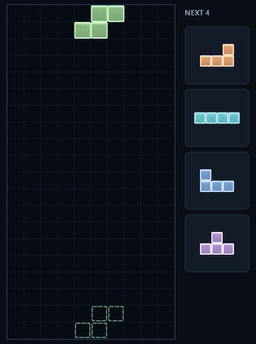
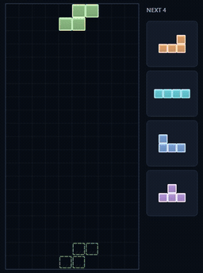
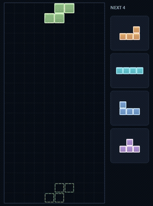

<h1>Eungjae Kim HighKcal</h1>

<strong>Soongsil University · AI Software</strong> 
AI · Systems · Security를 탐색하는 대학생 개발자입니다.

C와 Python을 기반으로 직접 구현하고 실험하며 소프트웨어의 동작 원리를 배웁니다. 성공한 결과뿐 아니라 실패와 원인 분석도 중요하게 생각합니다.

## Awards & Achievements

| Date | Award | Project |
| --- | --- | --- |
| 2026.10 | DevDay Exchange Community Hackathon: Seoul — Track 2 (AI for Human Life), **1st Place (팀 수상)** | [VIDEX](https://github.com/HighKcal/videx) |

## Featured Projects

<table>
  <tr>
    <td>
      강화학습 · 연구와 실험 기록
      <h3><a href="https://github.com/HighKcal/Learning-Without-Game-Heuristics">Learning Without Game Heuristics</a></h3>
      
DDQN 목표 배치·게임 전략 학습 연구입니다. Geometric Validity·Oracle BFS 비교, 실행 불가능한 배치 반복·학습 한계를 기록합니다.

      
미해결 연구입니다. Oracle의 실행 가능성은 외부 BFS mask의 효과로, 에이전트가 학습했다는 증거는 아닙니다.

      
<strong>테멍 시연 · 게임 seed 100000</strong> 
        01 — Geometric Baseline 100K / Research (Geometric top1) 
        02 — Penalty −0.20 500K / Research (Geometric top1) 
        03 — Oracle 2M / Physical Mask + witness
      

      

        
        
        
      

      
순서대로 표시한 동일 게임 시드의 개별 실행 사례입니다. 일반적인 성능 우열을 입증하는 비교는 아닙니다.

      
<code>Python</code> <code>PyTorch</code> <code>DDQN</code> 
        <a href="https://github.com/HighKcal/Learning-Without-Game-Heuristics">Code &amp; Research</a> ·
        <a href="https://github.com/HighKcal/Learning-Without-Game-Heuristics/releases/tag/research-v1.0.1">research-v1.0.1</a> ·
        <a href="https://github.com/HighKcal/Learning-Without-Game-Heuristics/releases/tag/research-v1.0.0">모델 9개 다운로드</a>
      

    </td>
  </tr>
</table>

<table>
  <tr>
    <td>
      인터랙티브 소프트웨어 · 개인 프로젝트
      <h3><a href="https://github.com/HighKcal/Live2D_Companion_Engine">Live2D Companion Engine</a></h3>
      
프로필 기반 Windows 데스크톱 캐릭터 엔진입니다. 쓰다듬기·간식·감정 반응을 캐릭터별 설정으로 연결합니다.

      
<strong>담당:</strong> 기획, UX·상호작용·시스템 설계, 동작 검증 
        구현·테스트에 OpenAI Codex 등 AI 도구를 활용했습니다.
      

      

      
시연 모델: @TianYeLulu. Live2D 모델 에셋은 저장소에 포함하지 않습니다. 
        다른 시연: <a href="./%EA%B0%84%EC%8B%9D%EC%A3%BC%EA%B8%B0_github.gif">간식 주기</a> · <a href="./%ED%99%94%EB%82%A8-%ED%92%80%EB%A6%BC_github.gif">화남 → 풀림</a>
      

      
<code>Python</code> <code>Live2D</code> <code>PySide6</code> <code>OpenGL</code> 
        <a href="https://github.com/HighKcal/Live2D_Companion_Engine">Code &amp; Design</a>
      

    </td>
  </tr>
</table>

<table>
  <tr>
    <td>
      임베디드 AI · 팀 협업과 해커톤 · 2026.10
      <h3><a href="https://github.com/HighKcal/videx">VIDEX</a></h3>
      
시각장애인의 일상생활·보행 지원을 목표로 한 팀 생일파티 (SSCC)의 프로젝트입니다.

      
<strong>개인 기여:</strong> OpenCV 장애물 탐지 알고리즘 설계·구현·실험, 스테레오 거리 추정 예비 실험. 최종 시연은 단안 탐지를 사용했습니다.

      
Track 2 — AI for Human Life · 1st Place (팀 수상) 
        수상·개인 기여: 직접 참여 경험에 근거. 공개 코드: USB 영상 수신·표시 뷰어.
      

      
<code>Python</code> <code>OpenCV</code> <code>Embedded AI</code> 
        <a href="https://github.com/HighKcal/videx">Team Repository</a> ·
        <a href="https://github.com/HighKcal/videx/blob/main/proxy/README-viewer.md">공개 뷰어 문서</a>
      

    </td>
  </tr>
</table>

## Tech Stack

`C` · `Python` · `PyTorch` · `OpenCV` · `PySide6` · `OpenGL` · `Live2D` · `Git` · `Linux / WSL`

## Currently Exploring

AI / LLM · Systems · Security · Reinforcement Learning
